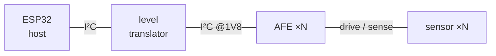

# <Board name>

> One sentence: what this board is and what question it exists to answer.

**Program:** <parent project> · **Repo:** `hardware/<dir>/`

---

## Rev 0 — <status>

*Status vocabulary, used exactly: concept → in design → routed → fabbed →
bring-up → working → retired.*

### At a glance

| | |
|---|---|
| **Status** | |
| **Date** | |
| **Purpose** | one line — why this board exists |
| **Host** | what drives it, and whether it is on the board |
| **Firmware** | `firmware/<dir>/` |
| **Pinned revision** | [`<sha>`](<repo-url>/commit/<sha>), <date> |

*The pinned revision is the last commit that touched **this board's** files, not
the repo HEAD. Two boards in one repo sit at different revisions, and the page
describes the files at that commit.*

### Board

One line on anything the renders do not show — flex regions, stiffeners, what
mounts where.

### Spec

| Parameter | Value |
|---|---|
| Board size | |
| Stackup | |
| Mounting holes | |

### Connectors

#### J1 — <value>

<N>-way, `<footprint>`, <side> side. Drawing viewed from the <top/bottom>; pin 1
outlined in red.

| Pin | Net | Note |
|---|---|---|
| 1 | `<net>` | |

### Architecture

One or two sentences: what talks to what, and the fact that explains why it is
built this way.

### Known issues & errata

Errata keep their IDs (E1, E2 …) for the life of the board, so a later rev can
cite the row that caused a change.

| # | Issue | Severity | Workaround | Fixed in |
|---|---|---|---|---|
| E1 | | *blocker / annoyance / cosmetic* | | |

### Files

| What | Where |
|---|---|
| Schematic / layout | |
| Fab package | |
| Firmware | |
| Review artifacts | |

---

## Rev 1 — <status>

*Same sections. The rev-0 section above is never rewritten — it is a record of
what was built, not a description of current state.*
