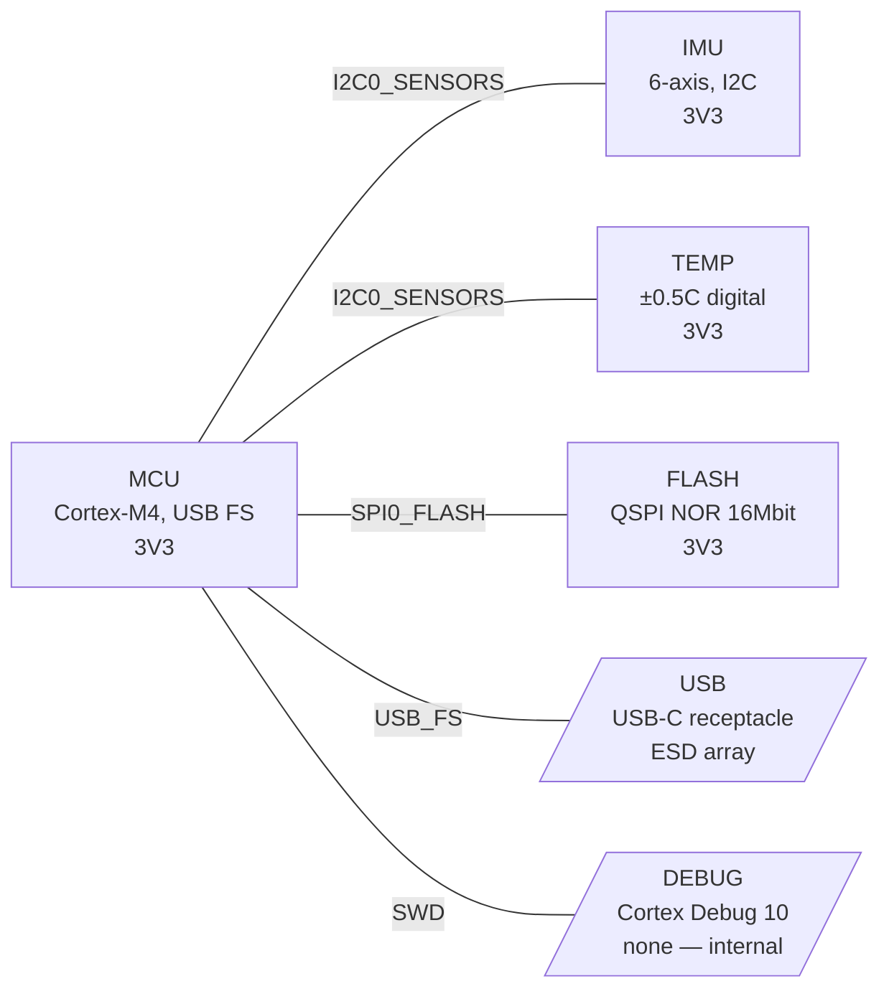

# architecture.md — format and worked fragment

`architecture.md` is the human-readable half of the output. `system.yaml` is for
the next skill; this file is for the engineer who has to approve the design and
the reviewer who reads it in a fresh session. Keep the section order below so
two projects' architecture files read the same way.

## Sections, in order

1. **Summary** — three or four sentences: what the board is, the MCU class
   chosen and why, the one or two decisions that were close calls.
2. **Block diagram** — Mermaid, see below.
3. **Blocks** — table: id, function, part_class, candidate_mpns, rails drawn from.
4. **Requirement trace** — table: requirement id → block ids. Then the reverse:
   any block with no requirement, and any `must` with no block (there should be
   none by the time you write this; if there are, say why).
5. **Buses and interfaces** — the `buses:` and `interfaces:` sections rendered
   as tables, plus the I2C address map per bus.
6. **Loads** — one table, blocks down the side, modes across, peak in the last
   column, in mA. Rail totals are *not* computed here; that is
   `power-architecture`'s arithmetic and duplicating it invites two answers.
7. **Resource count and pin allocation** — the Python output from below, then a
   table of peripheral instance → bus/signal it is allocated to. Under it, this
   sentence or its equivalent: *"Instance counts pass. Pinmux is not yet
   verified; part-spec must confirm from the alternate-function table that this
   allocation is realisable on the chosen package."*
8. **Checklist outcomes** — clocking, reset/supervisor, boot straps, level
   shifting, debug access, storage/identity, indicators. One line each:
   decision taken, or "deferred, open item A-nnn".
9. **Open items raised** — the ids appended to `open_items.yaml` by this run.

## Mermaid block diagram

Use `flowchart LR`. Blocks are rectangles, off-board interfaces are
parallelograms so the board edge is visible at a glance. Edges are labelled with
the bus id. Do not draw the power tree — rails appear as text in the block
label, and the tree itself belongs to `power-architecture`. Node order follows
`system.yaml` block order; edge order is buses then interfaces. Keep that order
stable on re-runs so a diff shows a design change and not a reshuffle.



Multi-drop buses are drawn as one edge per member with the same label; Mermaid
has no multi-endpoint edge and a shared node for the bus adds clutter without
adding information. Twelve blocks or fewer fits on one diagram; past that,
split by subsystem with one diagram each and keep the MCU in every one.

## Resource count — the snippet

Keep this inline in the session, not as a script file. It exists so the count is
arithmetic and not a glance. Fill `need` from the buses and interfaces you have
defined, `have` from the candidate's datasheet summary table.

```python
need = {"spi": 1, "i2c": 1, "uart": 1, "usb": 1, "can": 0,
        "adc_ch": 3, "timer": 2, "gpio": 14}
have = {"spi": 3, "i2c": 3, "uart": 4, "usb": 1, "can": 1,
        "adc_ch": 16, "timer": 7, "gpio": 37}     # candidate MCU, from datasheet
for k in need:
    spare = have[k] - need[k]
    pct = 100 * spare / have[k] if have[k] else 0
    flag = "SHORT" if spare < 0 else ("TIGHT" if pct < 20 else "ok")
    print(f"{k:8} need {need[k]:3} have {have[k]:3} spare {spare:3} ({pct:4.0f}%) {flag}")
```

`gpio` means pins with no peripheral function assigned: enables, interrupts,
LEDs, straps, buttons. Count the boot straps and the debug pins in `need`, since
they are unavailable at boot or during debug respectively even when they look
free. Count the MCU's total usable I/O pins in `have`, not its package pin
count — power, ground and dedicated pins are not I/O.

## I2C collision check — the snippet

```python
buses = {"I2C0_SENSORS": {"IMU": 0x68, "TEMP": 0x48, "EEPROM": 0x50}}
reserved = set(range(0x00, 0x08)) | set(range(0x78, 0x80))
for bus, addrs in buses.items():
    seen = {}
    for dev, a in addrs.items():
        if a in reserved:
            print(f"{bus}: {dev} at 0x{a:02X} is in a reserved range")
        if a in seen:
            print(f"{bus}: {dev} and {seen[a]} both at 0x{a:02X} — collision")
        seen.setdefault(a, dev)
    print(f"{bus}: {len(addrs)} devices, {len(seen)} unique addresses")
```

Where a collision is found, the usual fixes in order of cost are: the part's
address-select pin, the same part from a vendor with a different default, a
second I2C bus, an I2C mux. Record the choice in `architecture.md` and the
open item if it is not yet decided.
